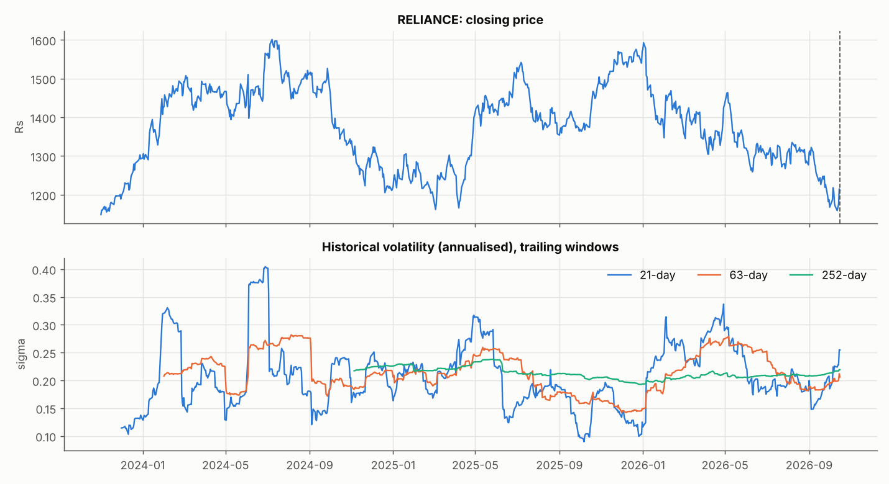
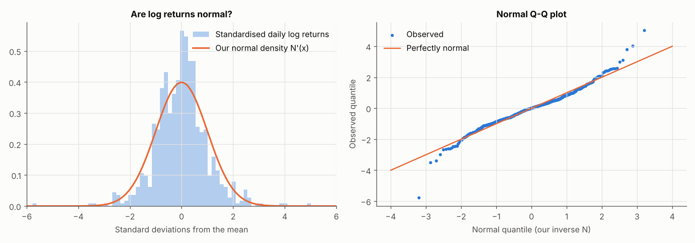
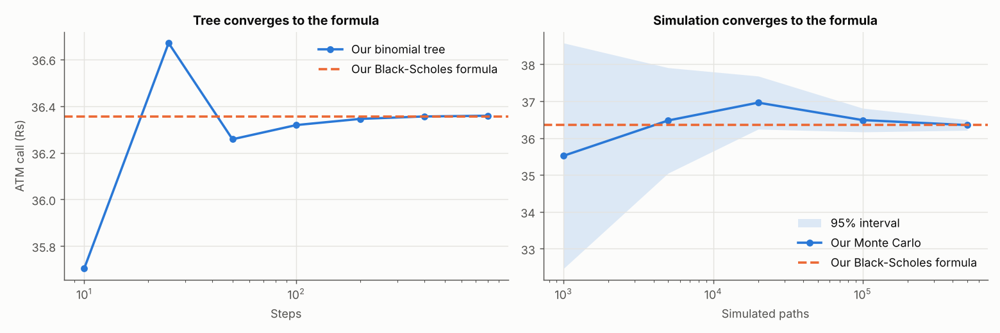
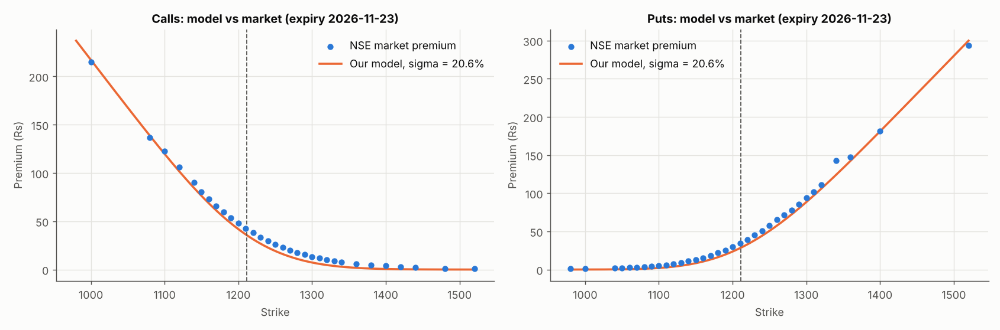
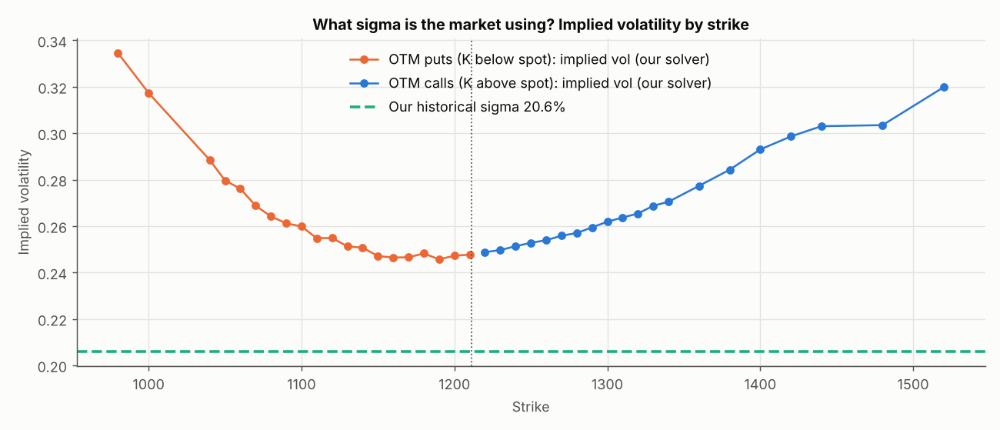
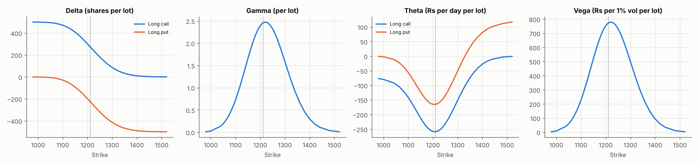
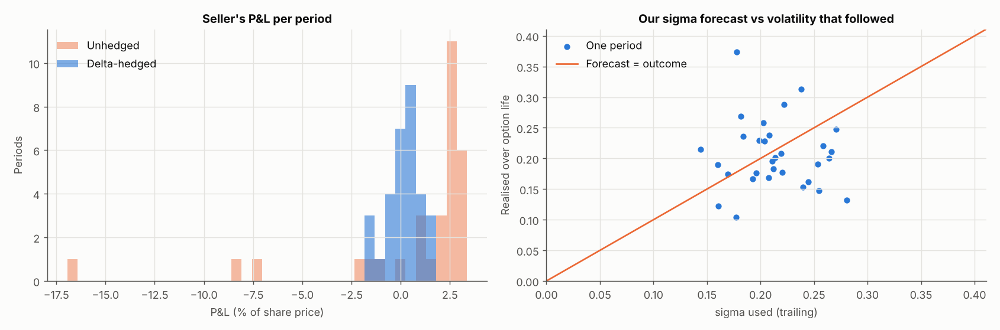

# Our Black-Scholes model vs the market: RELIANCE

## 1. The share

Price history 2023-11-01 to 2026-10-16 (735 trading days).

- Corporate action 2024-10-28: prices before this date divided by 2 (raw overnight move -49.8%).

| Statistic | Value | If ln S were exactly normal |
|---|---|---|
| Annualised volatility (whole sample) | 21.42% |  |
| Volatility used for pricing (63 days to 2026-10-16) | 20.61% |  |
| Skewness of daily log returns | +0.033 | 0 |
| Excess kurtosis | +3.056 | 0 |
| Days beyond 3 standard deviations | 0.95% | 0.27% |
| Worst / best day | -7.78% / +6.78% |  |

*Volatility is not constant over time, although our model assumes it is*

*Points bending away at the ends = fatter tails than the model assumes*

## 2. Inputs on 2026-10-16

Spot S0 = Rs 1,211.19; expiry 2026-11-23 (T = 38 days = 0.1041 years); r = 5.69% (assumption); PV of dividends D = Rs 0.00; sigma = 20.61% (63-day historical).

## 3. Is our engine right? Three independent methods

| Method (ATM call, K = 1,210) | Price | Difference from formula |
|---|---|---|
| Our Black-Scholes formula | 36.3555 | - |
| Our binomial tree, 800 steps | 36.3587 | +0.0032 |
| Our Monte Carlo, 500,000 paths | 36.3513 +/- 0.1434 | -0.0042 |
| Put-call parity on our prices: c - p - (S0 - D - Ke^-rT) | 0.00e+00 | should be 0 |

*Three routes, one answer*

## 4. Our model's prices vs NSE premiums

67 traded contracts (12 dropped with volume < 1: their 'prices' are stale).

| Group | Contracts | Mean (model - market), Rs | Mean abs error, Rs | Median % error |
|---|---|---|---|---|
| calls ITM | 8 | -2.78 | 3.73 | -4.6% |
| calls ATM | 7 | -6.26 | 6.26 | -14.9% |
| calls OTM | 17 | -4.65 | 4.65 | -58.8% |
| puts ITM | 12 | -5.59 | 6.58 | -6.3% |
| puts ATM | 7 | -6.30 | 6.30 | -18.7% |
| puts OTM | 16 | -3.02 | 3.02 | -62.6% |

*Dashed line = spot. Gaps show where the market disagrees with our sigma*

*Out-of-the-money options only: in-the-money premiums are mostly intrinsic value, so their implied vol is unreliable. Our model assumes one sigma for every strike.*

ATM implied volatility = **24.77%** vs our historical estimate 20.61%. The full table is in chain.csv.

## 5. Does the market obey put-call parity?

c - p should equal S0 - D - K e^(-rT). Deviation per strike (Rs):

| Strikes with both legs traded | Mean deviation | Mean absolute deviation | Largest absolute deviation | Mean absolute as % of spot |
|---|---|---|---|---|
| 27 | -0.39 | 1.52 | 13.90 | 0.126% |

*Risk of one lot (500 shares) at each strike, from our model*

## 6. Backtest: selling a 1-month ATM call at our price and delta-hedging it

31 non-overlapping periods. Each starts with sigma = trailing 63-day volatility (only information known that day) and rebalances at every daily close. P&L is per call sold, as % of the share price.

| Seller's strategy | Mean P&L | Std of P&L | Periods with profit | Worst period |
|---|---|---|---|---|
| Delta-hedged (Black-Scholes) | +0.177% | 0.834% | 61% | -1.65% |
| Unhedged (just collect premium) | +0.644% | 4.315% | 77% | -16.94% |

Correlation between hedged P&L and (sigma used^2 - realised vol^2): **+0.83**. Black-Scholes predicts this should be strongly positive: the hedger gains when the share turns out calmer than the sigma charged, and loses when it is wilder.

*Hedging shrinks the seller's risk; what remains comes from mis-forecast volatility*
